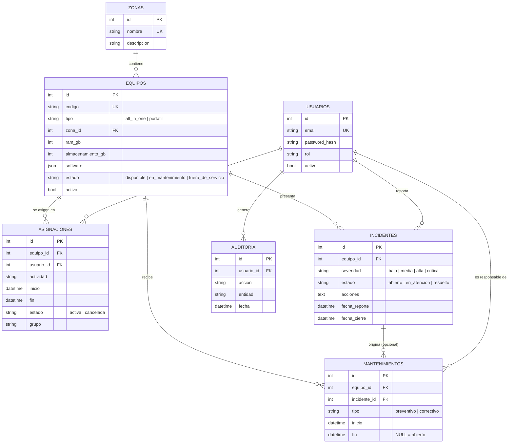

# Modelo de datos

Notas de diseño:

- `estado` del equipo se **deriva** de incidentes graves abiertos y mantenimientos abiertos (`app/services/equipos.py`).
- `activo = false` es la baja lógica: el equipo conserva su historial (trazabilidad).
- `asignaciones.grupo` agrupa las asignaciones creadas por una misma solicitud de varios equipos.
